<!-- 👇 Reemplaza TU_USUARIO con tus redes -->

---

### Esto soy yo :)

¡Hola! Soy **Jordy**, estudiante de **Ingeniería Informática** en la **Universidad Peruana Cayetano Heredia**, programando desde **Lima, Perú** 🇵🇪. Me apasiona **programar y automatizar con Inteligencia Artificial**: convertir tareas repetitivas en sistemas que trabajan solos, para que las personas tengan tiempo para lo que de verdad importa.

- 🤖 **Obsesionado con:** IA aplicada, agentes y automatización. Si se repite dos veces, se automatiza.
- ⚡ **Construyendo:** [OMNICONVERT](https://github.com/jordymartel-hash/OMNICONVERT), un conversor universal hecho en Python.
- 🖥️ **Creando:** [SORANE](https://github.com/jordymartel-hash/SORANE), un asistente de escritorio para Windows, y mi nuevo proyecto [VERIDIA](https://github.com/jordymartel-hash/VERIDIA).
- 🧪 **Innovando:** con mi equipo en [PI_Equipo05](https://github.com/jordymartel-hash/PI_Equipo05), un proyecto de Procesos de Innovación.
- 🎓 **Aprendiendo:** cada día algo nuevo. Este es solo el comienzo de mi carrera.
- 🌎 **Mi misión:** usar la tecnología para **servir a la sociedad** y crear soluciones con impacto real.
- 💬 **Háblame de:** IA, automatización, proyectos locos y el futuro de la tecnología en LATAM.

---

### featured projects

---

### my perfect stack ✦

---

### signals

---

### Numbers matter? ohhh yes.

---

### snake.exe

