<div align="center">




<br/>



<br/>

```diff
+ [ CONEXIÓN ESTABLECIDA ]  >>  Bienvenido, netrunner.
- [ UBICACIÓN ]             >>  Tierra // Sector Latam
```

</div>

---

<div align="center">

## `// 01 :: STATS`


## `// 02 :: ARSENAL`


## `// 03 :: CANALES DE CONEXIÓN`

<a href="mailto:TU_CORREO@ejemplo.com"></a>
<a href="https://instagram.com/TU_USUARIO"></a>
<a href="https://discord.com/users/TU_ID"></a>
<a href="https://wa.me/TU_NUMERO"></a>
<a href="https://twitch.tv/TU_USUARIO"></a>
<a href="https://linkedin.com/in/TU_USUARIO"></a>
<a href="https://github.com/jordymartel-hash"></a>

<br/><br/>

<code>⚡ <a href="https://github.com/jordymartel-hash?tab=repositories">repos</a> ⟡ <a href="https://linktr.ee/TU_USUARIO">linktree</a> ⟡ <a href="https://TU_SITIO.carrd.co">carrd</a> ⟡ <a href="https://notion.so/TU_PAGINA">notion</a> ⚡</code>

<br/><br/>


</div>
